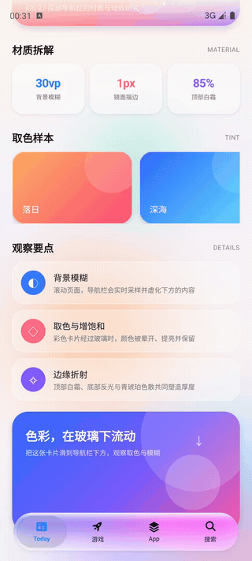
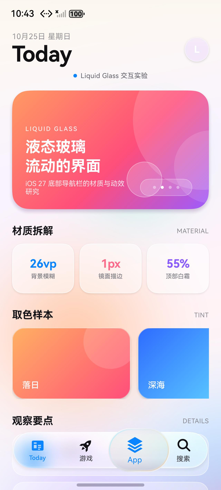
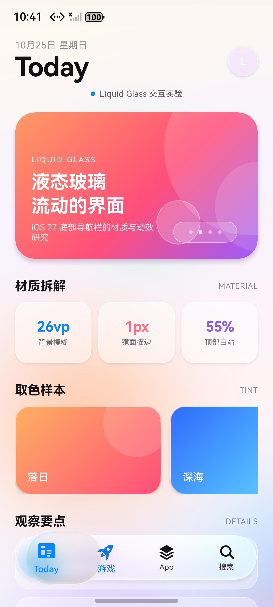

# LiquidGlass · 鸿蒙液态玻璃底部导航栏

用 ArkUI 手写还原 iOS 27 App Store 的**悬浮液态玻璃 TabBar**：实时背景模糊、顶部白霜、镜面描边、选中玻璃透镜、膨胀回弹与青琥珀色散。

> 目标设备：HarmonyOS 模拟器（API 20，1280 × 2832）
> 构建配置：`compatibleSdkVersion 4.0.0(10)`，`targetSdkVersion 26.0.0`
> 实际能力下限为 **API 12**（`backgroundEffect` 11、`clip` 12、`getUIContext` 11）


## 录屏演示

在鸿蒙模拟器上录制：macOS AVFoundation 抓取模拟器所在显示器，裁到设备画面，再用 `hdc` 注入按住拖动与点击。



[MP4 版本](docs/demo.mp4)

## 效果拆解

| 层 | 做法 |
| --- | --- |
| 背景模糊 | `backgroundEffect({ radius: 26, saturation: 2.0, brightness: 1.06 })` |
| 顶部白霜 → 中部清澈 → 底部反光 | 纵向白色 `linearGradient` |
| 镜面描边 / 高光 / 色散 | `GlassRim` Canvas 绘制 |
| 选中透镜 | 独立玻璃胶囊，二次模糊 + 烟熏 + 内阴影 |
| 覆盖着色 | 透镜经过的图标 / 文字渐变为选中蓝，离开后回到墨色 |
| 膨胀 / 弹射 | `animateTo` + `curves.springMotion` |
| 彩色背景 | 预渲染 PNG 光斑，缓慢漂移 |
| 沉浸式 | 全屏 + `getWindowAvoidArea` 安全区 |

选中切换：透镜先在 170 ms 内膨胀到 `1.35 × 1.35`，明显高出、长出导航栏；放大前后保持相同的玻璃填充、描边与清晰度，不会因为放大而变透明。**只放大导航栏自身的图标与文字**，栏后的页面内容不缩放，只保留玻璃的模糊与取色。

透镜经过时，被覆盖的标签图标与文字会渐变为选中蓝：颜色按透镜中心到标签中心的距离混合，透镜离开后再退回墨色，看起来像透过一层被染成系统蓝的玻璃。落点始终吸附到最近的标签；**即使最近的就是当前标签，透镜也会流回原位，不会停在两个标签之间**。



## 目录

```
entry/src/main/ets/
├── pages/Index.ets                 # 页面、滚动内容、安全区
└── components/
    ├── LiquidTabBar.ets            # 液态玻璃 TabBar
    ├── GlassRim.ets                # Canvas 镜面描边 / 色散
    └── AuroraBackground.ets        # 漂移彩色背景

entry/src/main/resources/base/media/
├── tab_today.svg / tab_game.svg / tab_apps.svg / tab_search.svg
├── blob_*.png                      # 背景光斑
└── glow_white.png                  # 切换 bloom
```

详细拆解、尺寸测量、动效参数与还原度对照见 **[docs/analysis.md](docs/analysis.md)**。

## 运行

```bash
export DEVECO_SDK_HOME=/Applications/DevEco-Studio.app/Contents/sdk
/Applications/DevEco-Studio.app/Contents/tools/hvigor/bin/hvigorw --no-daemon assembleHap

hdc -t 127.0.0.1:5555 install -r \
  entry/build/default/outputs/default/entry-default-unsigned.hap

hdc -t 127.0.0.1:5555 shell aa start \
  -a EntryAbility -b io.xuxiaowei.liquidglass
```

> 模拟器已开启开发者模式，可直接安装未签名 HAP。DevEco 自动生成的 `entry-default-signed.hap` 用于真机签名环境；当前模拟器与自动签名信息不一致，安装会报 `install sign info inconsistent`，因此模拟器调试使用未签名包。

## 操作

- 上下滚动：把彩色卡片滑到导航栏下方，观察取色、模糊与高光变化。
- 点击四个标签：观察透镜的膨胀、弹射和回弹。
- 按住标签不松手：**导航栏本身不放大**，选中气泡膨胀到 **1.45×**；气泡放大前后清晰度一致，不会变透明。**气泡下的导航栏图标/文字会随位置放大 1.0–1.3×，并渐变为选中蓝；栏后的页面内容不缩放**；松开后气泡回弹并切页。
- 按住后左右拖动：气泡连续跟手流动；覆盖到的标签会变蓝，离开后复原。松手后**总是吸附并流动到最近的标签**，即使最近的就是当前标签也会流回原位，不会停在半路。



## 已知差异

- 按当前需求，本项目**只放大导航栏自身的图标/文字**，不对栏后的页面内容做折射或放大；iOS 参考里的背景折射在这里用模糊、增饱和与镜面边近似。
- 覆盖着色按标签整体渐变，而不是逐像素只染透镜内的那一小块；ArkUI 在动画中动态裁剪图片层的层级不可靠，因此用整枚标签的颜色混合来近似。
- 字体为 HarmonyOS Sans，而非 SF Pro。
- 系统 Home Indicator 样式由模拟器决定。
