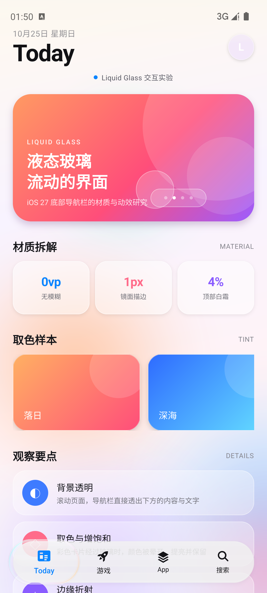
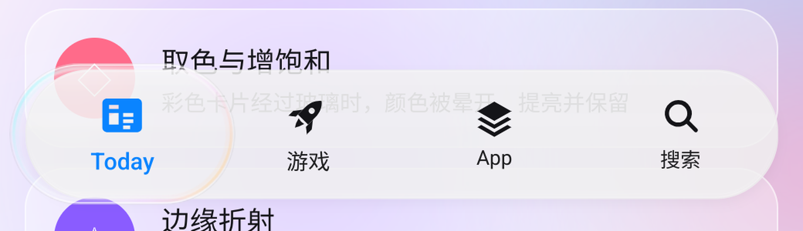
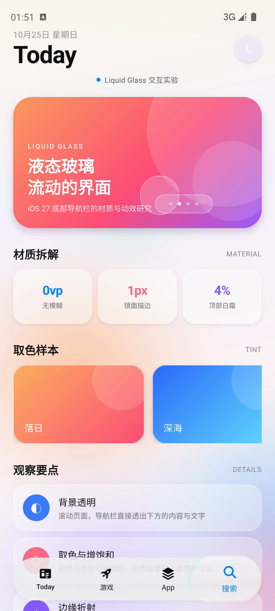
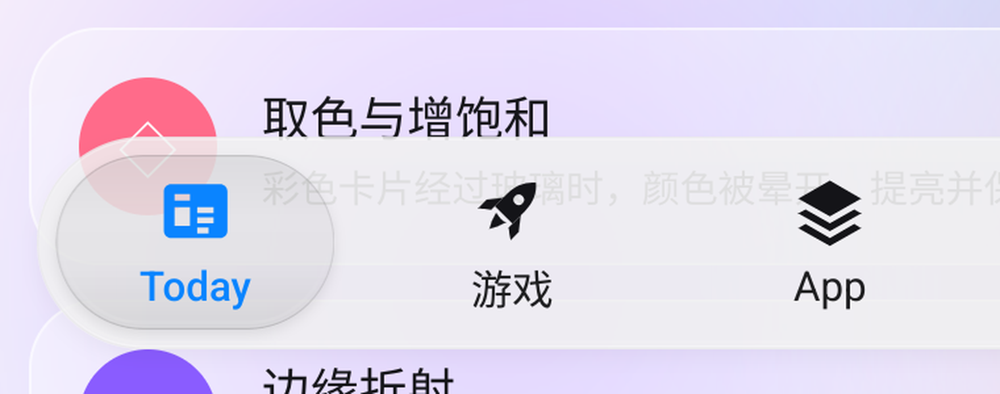
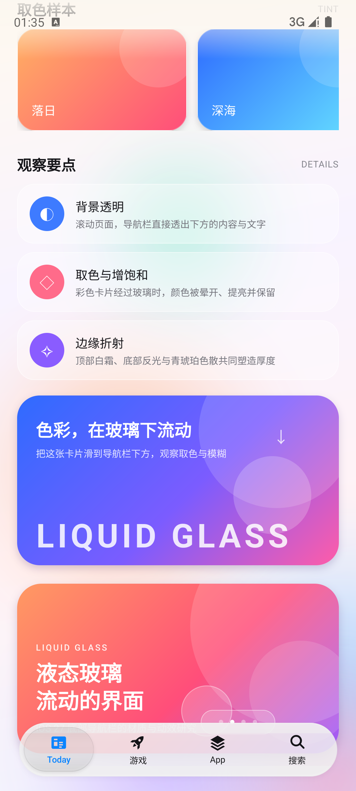
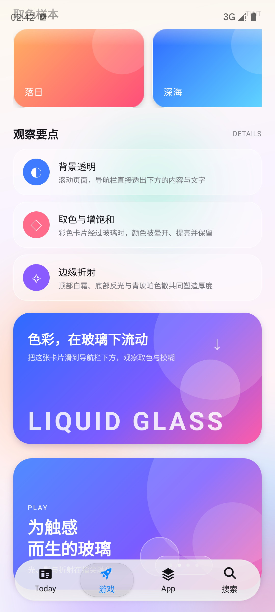
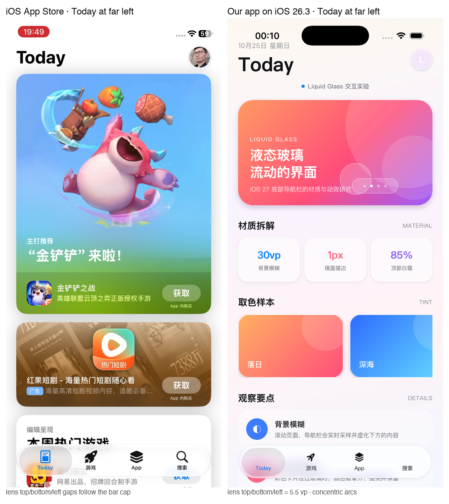

# LiquidGlass · 鸿蒙液态玻璃底部导航栏

用 ArkUI 手写还原 iOS 27 App Store 的**悬浮液态玻璃 TabBar**：浅灰半透明、无模糊的玻璃层、极轻白霜、暗色接触线 + 细镜面高光、静止 / 活跃双态玻璃透镜、抬升投影与青琥珀色散。

> 目标设备：HarmonyOS 模拟器（API 20，1280 × 2832）
> 跨平台验证：ArkUI-X + Android 模拟器（Pixel 8 / API 34，1080 × 2400）、iOS 模拟器（iPhone 17 Pro / iOS 26.3，1206 × 2622）
> 构建配置：`compatibleSdkVersion 4.0.0(10)`，`targetSdkVersion 26.0.0`
> 实际能力下限为 **API 12**（`clip` 12、`getUIContext` 11、`componentSnapshot` 10）


## 录屏演示

最新版在 Android 14 模拟器上录制：`adb shell screenrecord` 抓取点击与按住拖动，再转成 GIF；同一份 ArkUI 代码也在 HarmonyOS API 20 与 iOS 26.3 模拟器上验证。导航栏几何按 App Store 参考统一为 **62 vp 高、距屏幕底部 17 vp**。


[MP4 版本](docs/demo.mp4)

## 效果拆解

| 层 | 做法 |
| --- | --- |
| 背景透明 | **不使用 `backgroundEffect`**：栏体是一层约 **85% 浅灰**（`#F0F0F0`）+ 顶部 4% / 中部 0.4–1% / 底部 2% 白、0.5% 冷色和镜面边；背后内容以约 15% 透出，不做模糊 |
| 边缘透视带 | 滚动停止时用 `componentSnapshot` 截取页面，在上下各 12 vp 的 Canvas 中做纵向压缩 + 横向内收（24 条切片）；滚动时隐藏，静止时显示。变形的是一张静止快照，不是实时背景 |
| 顶部白霜 → 中部清澈 → 底部反光 | 纵向白色 `linearGradient`：顶部 4% → 3% → 2% → 1.2% → 0.8% → 0.4% → 0.4% → 0.8% → 2% |
| 镜面描边 / 高光 / 色散 | `GlassRim` Canvas：0.5 vp 暗色接触线 + 0.5 vp 白色高光（只在上下唇最亮）+ 底部反光线 + 可选的青 / 琥珀色散 |
| 选中透镜 | 宽扁胶囊（≈ 81 × 51 vp，tab 宽 − 11）；左右内缩与上下同为 5.5 vp，端部圆弧与栏体端部同心；静止是 4% 烟灰 + 灰边 + 软投影。**按住时栏体外框 +2 高 / +4 长；气泡覆盖区从栏体灰底中挖空，气泡内部和溢出栏体的部分全透明，栏体其余保持浅灰，气泡后方的栏体不额外增高** |
| 覆盖着色 | 颜色完全由透镜覆盖决定：只有被气泡盖住的图标 / 文字是选中蓝；当前标签在气泡离开后也会回到墨色 |
| 膨胀 / 弹射 | `animateTo` + `curves.springMotion`（点击 1.34×，按住 1.38×） |
| 彩色背景 | 预渲染 PNG 光斑，缓慢漂移 |
| 沉浸式 | 全屏 + `getWindowAvoidArea` 安全区；Android 端用 `AppTheme` 把状态栏图标切成深色 |

### 透明与“白霜”的平衡

视频里的栏不是“一层半透明白”，而是**近透明的玻璃 + 一层集中在顶部的霜**。实现按这个比例分层：

- 顶部只保留 4% 白，几乎看不出“上唇”；
- 中部只留 0.5–1% 白，让背后的文字和颜色直接透出来；
- 底部只抬到 2% 白，几乎不再有白色反光边；
- 边缘先用 0.5 vp 的暗色接触线勾出边界，再叠 0.5 vp 的白色高光。没有暗线时，白背景上只剩一圈白边，看起来像贴纸；有了暗线，它才像一块有厚度的玻璃。
- 高光不是均匀一圈：纵向渐变在顶部和底部最亮，左右两侧几乎消失，这正是视频里“上下亮、侧面透明”的镜面边。

### 中间清楚，边缘透视（快照带）

ArkUI API 20 / ArkUI-X 的实时 `backgroundEffect` 没有背景位移采样：实测 `scale`、`translate`、`pixelStretchEffect`、3D `rotate` 都不会让实时背景产生几何变形。

因此边缘透视改走**静止快照**：

- 栏体中心不做任何背景模糊，只叠一层 85% 浅灰玻璃 + 极淡白色/冷色层，文字以约 15% 透出；
- 每次滚动停止后用 `componentSnapshot` 截取 Scroll，在上下各 12 vp 的 Canvas 中重绘；
- 条带把源图纵向压缩到 **0.70×**、边缘横向内收约 **10%**，用 24 条切片绘制；靠近边框的内容被压缩/内收，形成透视变形；
- 条带锚定在内侧边缘，所以与栏体中间的内容衔接；滚动时隐藏，静止后约 0.1–0.5 s 出现。

代价是：透视只对**静止快照**生效，滚动过程中没有变形；快照和实时内容之间可能有一帧级的差异。这是当前跨平台 ArkUI 下实现真实边缘透视的取舍。

> 演示页收尾卡片底部有一行大号 `LIQUID GLASS` 水印。滑到导航栏下方并停住，可以看到条带对文字的压缩/透视；栏体中间是浅灰半透明、无模糊的材质。

### 透镜的两态

逐帧看参考视频，选中透镜并不是一直“亮着”的：

1. **静止态**：约 4% 烟灰的宽扁胶囊，边缘只有一圈很淡的灰线，下方有 8 vp 软投影。白底上它是浅灰饼（视频取色约 `#EBEBEB`，栏体 `#FEFEFE`）；彩底上它只比栏体暗一点、颜色更实。
2. **活跃态**：手指按下、拖动或刚切换完成时，透镜变成一块清透玻璃：顶部 32% 白高光、青 / 琥珀色散，同时膨胀 1.34–1.38×。按住时栏体外框 +2 高 / +4 长，气泡覆盖区被挖空，气泡内部与溢出部分完全透明。
3. **冷却**：落位约 0.5 s 后，`lensActive` 在 680 ms 内回落到 0，色散、强高光和强投影一起退去，只留下静止态的烟灰胶囊。

透镜内部不再叠背景模糊：静止时它是一枚 4% 烟灰、带镜面边和软投影的浅灰胶囊。按住后，栏体用 Canvas 在气泡位置挖出透明孔，透镜自身的烟灰、厚度渐变和投影一起淡出，所以气泡内部、栏体其余部分之外的气泡悬出区域都直接露出页面。









最左侧时，透镜左端与栏体左端共用同一个圆心：栏体端部半径 31、透镜端部半径 25.5，左右内缩与上下一样取 5.5 vp，因此两条左圆弧之间的间距处处相等。



### 页面底部的重复 HeroCard

每个 tab 的 `HeroCard` 在收尾卡片之后会再出现一次，并随 tab 切换更新标题、副标题、主题色和底部预览：





## 目录

```
entry/src/main/ets/
├── pages/Index.ets                 # 页面、滚动内容、安全区
└── components/
    ├── LiquidTabBar.ets            # 液态玻璃 TabBar
    ├── GlassRim.ets                # Canvas 接触线 / 镜面高光 / 色散
    └── AuroraBackground.ets        # 漂移彩色背景

entry/src/main/resources/base/media/
├── tab_today.svg / tab_game.svg / tab_apps.svg / tab_search.svg
└── blob_*.png                      # 背景光斑

.arkui-x/android/
├── app/src/main/AndroidManifest.xml
└── app/src/main/res/values/styles.xml   # 深色状态栏图标 + 透明系统栏
```

详细拆解、尺寸测量、逐帧动效参数与还原度对照见 **[docs/analysis.md](docs/analysis.md)**。

## 运行

### HarmonyOS 模拟器

```bash
export DEVECO_SDK_HOME=/Applications/DevEco-Studio.app/Contents/sdk
/Applications/DevEco-Studio.app/Contents/tools/hvigor/bin/hvigorw --no-daemon assembleHap

hdc -t 127.0.0.1:5555 install -r \
  entry/build/default/outputs/default/entry-default-unsigned.hap

hdc -t 127.0.0.1:5555 shell aa start \
  -a EntryAbility -b io.xuxiaowei.liquidglass
```

> 模拟器已开启开发者模式，可直接安装未签名 HAP。DevEco 自动生成的 `entry-default-signed.hap` 用于真机签名环境；当前模拟器与自动签名信息不一致，安装会报 `install sign info inconsistent`，因此模拟器调试使用未签名包。

### Android 模拟器（ArkUI-X）

```bash
export DEVECO_SDK_HOME=/Applications/DevEco-Studio.app/Contents/sdk
/Applications/DevEco-Studio.app/Contents/tools/hvigor/bin/hvigorw --no-daemon assembleApp

adb -s emulator-5556 install -r \
  .arkui-x/android/app/build/outputs/apk/release/app-release.apk

adb -s emulator-5556 shell am start -n \
  io.xuxiaowei.liquidglass/io.xuxiaowei.liquidglass.EntryEntryAbilityActivity
```

> `assembleApp` 同时产出 HarmonyOS HAP、Android APK 与 iOS 工程。`CrossplatformPackageAsApp` 只重打 Android 包，不会重新编译 ArkTS，所以改完 `.ets` 之后仍然要跑一次 `assembleApp`（或 `assembleHap`）。
>
> Android 端的状态栏图标颜色由 `.arkui-x/android/app/src/main/res/values/styles.xml` 的 `windowLightStatusBar` 控制；ArkTS 侧的 `setWindowSystemBarProperties` 在 ArkUI-X 上不会作用到 Android 系统栏。

### iOS 模拟器（ArkUI-X）

```bash
# 先生成 iOS 的 ArkTS 资源
/Applications/DevEco-Studio.app/Contents/tools/hvigor/bin/hvigorw --no-daemon assembleApp

# 编译模拟器版本
cd .arkui-x/ios
xcodebuild -project app.xcodeproj -scheme app -configuration Debug \
  -sdk iphonesimulator -destination 'platform=iOS Simulator,name=iPhone 17 Pro' \
  -derivedDataPath /tmp/iosbuild CODE_SIGNING_ALLOWED=NO build

# 启动模拟器并安装
xcrun simctl boot "iPhone 17 Pro"
open -a Simulator
xcrun simctl install booted /tmp/iosbuild/Build/Products/Debug-iphonesimulator/app.app
xcrun simctl launch booted io.xuxiaowei.liquidglass
```

> iOS 端的安全区是 34 pt；底部间距公式 `max(17, safeBottom − 17)` 会得到 17 pt，与 App Store 的 17 pt 对齐。导航栏高度 62 vp≈62 pt，参考实测约 62.5 pt。

## 操作

- 上下滚动：把彩色卡片滑到导航栏下方，观察透明取色、边缘透视与高光变化。
- 点击四个标签：透镜膨胀 → 流动 → 落位回弹；落位后约 1 s 从清透玻璃冷却为静止烟灰态。
- 按住标签不松手：**栏体外框 +2 高 / +4 长**，选中气泡膨胀到 **1.38×**；气泡覆盖区在栏体灰底上被挖空，气泡内部和溢出栏体的部分全透明，栏体其余保持浅灰，气泡后方的栏体不额外增高。**气泡下的导航栏图标/文字会随位置放大 1.0–1.22×，并渐变为选中蓝；栏后的页面内容不缩放**；松开后气泡回弹并切页。
- 按住后左右拖动：气泡连续跟手流动；覆盖到的标签会变蓝，离开后复原。**原来的当前标签也会在气泡离开后回到墨色**，蓝色只属于被气泡盖住的图标 / 文字。松手后**总是吸附并流动到最近的标签**，即使最近的就是当前标签也会流回原位，不会停在半路。
- Android 模拟器上支持同样的点击、按住与拖动；录屏中即为 Pixel 8 / API 34 的实际表现。

## 已知差异

- 实时背景不做模糊或几何位移；栏体是 85% 浅灰 + 15% 页面颜色。边缘透视由**静止快照 + Canvas 切片**补上，滚动时隐藏。
- 透镜的“静止灰”和“活跃玻璃”是同一胶囊上的两层材质，通过 `lensActive` 交叉淡化近似；iOS 使用实时光场。
- 覆盖着色按整枚标签渐变，而不是逐像素只染透镜内的那一小块；ArkUI 在动画中动态裁剪图片层不可靠，因此用整枚标签的颜色混合来近似。
- 字体：HarmonyOS 端为 HarmonyOS Sans，iOS 端为系统 SF Pro；两端的字形宽度略有差异。
- 系统 Home Indicator / 手势条样式由模拟器或系统决定；Android 主题只负责状态栏图标明暗，不改变系统手势条。



