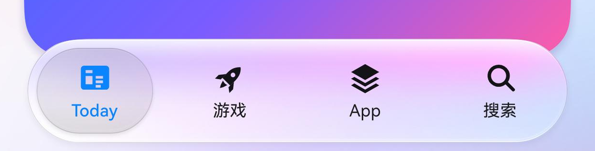
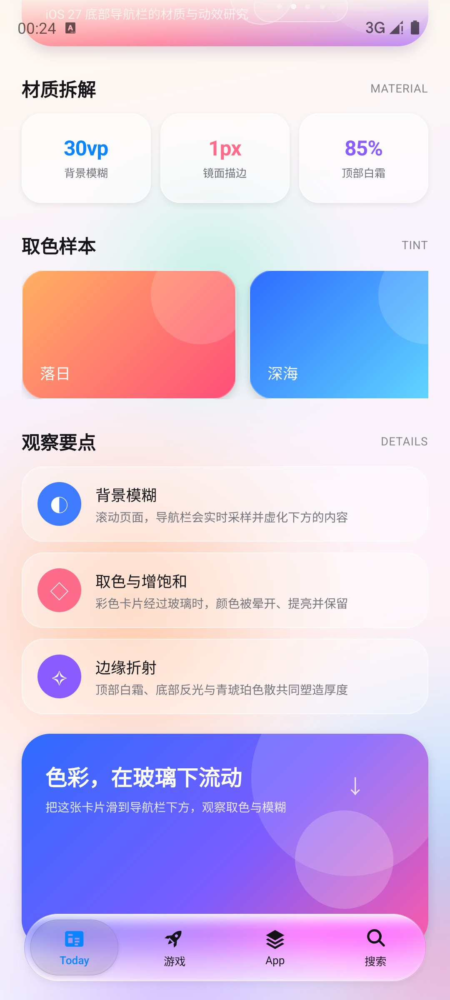
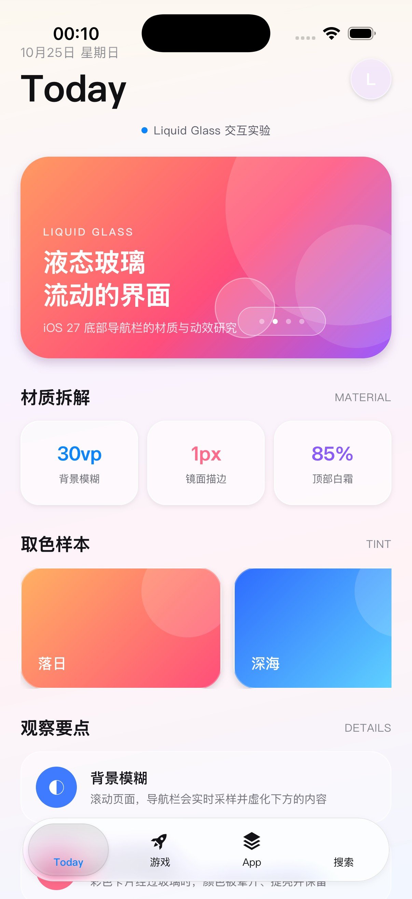

# iOS 27 液态玻璃底部导航栏 · 逐帧拆解与 ArkUI 实现

> 参考素材：`ScreenRecording_10-25-2026 19-48-45_1.MP4`（828 × 1792，60 fps，19.25 s）
> 实现环境：DevEco Studio / HarmonyOS SDK 26，目标模拟器 API 20（1280 × 2832）
> 跨平台验证：ArkUI-X + Android 模拟器 Pixel 8 / API 34（1080 × 2400）、iOS 模拟器 iPhone 17 Pro / iOS 26.3（1206 × 2622）
> 构建配置：`compatibleSdkVersion 4.0.0(10)`；实际使用的能力下限为 **API 12**


---

## 1. 视频里到底发生了什么

这段录屏是 iOS 27 App Store 的底部标签栏。它不是传统“贴着屏幕底边、横贯全屏”的 TabBar，而是一块**悬浮的液态玻璃胶囊**：

- 四个标签：`Today / 游戏 / App / 搜索`。
- 整条栏悬浮在内容之上，左右留边、底部留边，四角为完整半圆。
- 内容（彩色卡片、文字、图标）会从栏下方滚过，栏实时采样背景并模糊。
- 点击标签时，选中态不是简单的“换个底色”，而是一颗**会膨胀、会流动的玻璃透镜**在标签之间弹射。
- 选中标签的图标和文字变为系统蓝，未选中为近黑色。

逐帧看，还有三件容易被忽略的事：

1. **透镜有“静止 / 活跃”两种材质。** 在 5.2 s、11.8 s 这种静止帧里，透镜是一颗低对比度的烟灰色胶囊，边缘几乎只是灰线；而在 4.2 s、12.6 s、13.2 s 这些刚按下 / 正在移动的帧里，同一颗透镜突然变得清透，出现明亮的白高光、青 / 琥珀色散和更重的投影。落位一段时间后，它又冷却回灰色。
2. **栏体远比“半透明白”透明，但顶部霜很重。** 在纯白内容上，栏体几乎就是白色；但在紫 / 橙 / 青卡片经过时，颜色会清楚地透出来，只是被一层集中在顶部的霜提亮、去饱和了。底部反而是最透明的地方。
3. **边缘是“暗线 + 亮线”两条。** 视频 13.2 s 的竖直截面上，栏外是紫色 `(121,98,255)`，栏边第一行是更暗的 `(101,82,197)`，第二行才是纯白的高光 `(255,252,255)`；底部同样先有一条暗线，再进入背景。只有白色描边时，栏在白底上会变成一张贴纸。

---

## 2. 几何尺寸（按 2x 像素反推）

| 项目 | 视频测量 | 换算 | 当前实现 |
| --- | --- | --- | --- |
| 屏幕 | 828 × 1792 px | 414 × 896 pt | Android 1080 × 2400 / HarmonyOS 1280 × 2832 / iOS 1206 × 2622 |
| 胶囊栏 | 740 × 125 px | 370 × 62.5 pt | 屏宽 − 44 vp，高 62 vp |
| 左右留边 | 44 px | 22 pt | 22 vp |
| 底部留边 | 34 px | 17 pt | `max(17, safeBottom − 17)` |
| 圆角 | 62 px | 31 pt | 31 vp（= 高度的一半） |
| 标签单元 | 185 px | 92.5 pt | 栏宽 / 4 |
| 图标 | ≈ 40 px | ≈ 20 pt | 20 vp |
| 文字 | ≈ 20 px | ≈ 10 pt | 10 fp |
| 选中透镜 | ≈ 178 × 102 px | ≈ 89 × 51 pt | (栏宽 / 4 − 11) × 51 vp |
| 透镜内缩 | 4 px / 11.5 px | 2 pt / 5.75 pt | x 5.5 vp，y 5.5 vp（同心） |
| 活跃态膨胀 | 约 1.35× | — | 点击 1.34×，按住 1.38× |

也就是：**栏高 62 vp、胶囊半径 31 vp、四个等宽标签、选中态是一颗又宽又扁的胶囊**。透镜不是一个小圆钮——它的高度约为栏高的 4/5，上下左右都留 5.5 vp。左右采用与上下相同的 5.5 vp 内缩不是随意取值：栏体端部半径 31、透镜端部半径 25.5，内缩 5.5 后两个圆心重合，透镜在最左 / 最右标签时与栏体端部形成同心圆弧，间距处处相等。代价是透镜比参考测得的 89 pt 略窄（约 81 vp），但参考的 2 pt 侧边距本身会让两段圆弧不同心。

---

## 3. 材质：不是“半透明白”，而是一叠薄玻璃

逐帧取色后，这条栏至少由五层组成。

### 3.1 背景模糊 + 增饱和

栏后的内容被明显模糊，但仍保留大色块的方向和色相。视频里紫色卡片经过栏下时会变成柔和的淡紫，橙色卡片会变成奶油橙，而不是纯灰。

在鸿蒙上对应：

```ts
.backgroundEffect({
  radius: 30,       // 实时背景模糊
  saturation: 1.9,  // 把背景的颜色“提”出来
  brightness: 1.06
})
```

> 早期版本用了 `radius: 26 / saturation: 2.0`；增强后能更明显地看到卡片颜色被晕开，同时不会像高饱和滤镜那样发脏。

### 3.2 顶部白霜 → 中部清澈 → 底部反光

这是最容易被忽略、却最像“玻璃”的一层：

- 顶部 8%–18% 有一条明显的奶白色霜带（视频取色约 60%–85% 白）。
- 中部白度快速下降，背景颜色透出来；实测栏体中部的白色覆盖只有 6%–12%。
- 底部再出现一条较亮的反光边，像是玻璃的“下唇”。

当前实现为一条纵向白色渐变：

```ts
.linearGradient({
  angle: 180,
  colors: [
    ['#D9FFFFFF', 0.00], // 85%，顶部霜
    ['#C2FFFFFF', 0.04], // 76%
    ['#9EFFFFFF', 0.08], // 62%
    ['#7AFFFFFF', 0.12], // 48%
    ['#4DFFFFFF', 0.18], // 30%
    ['#2EFFFFFF', 0.24], // 18%
    ['#1CFFFFFF', 0.32], // 11%
    ['#12FFFFFF', 0.45], // 7%，中部几乎全透
    ['#0FFFFFFF', 0.62], // 6%
    ['#17FFFFFF', 0.82], // 9%
    ['#42FFFFFF', 1.00]  // 26%，底部反光
  ]
})
```

这组数值是“透”和“霜”的平衡点：再少一点，栏会变成彩色塑料片；再多一点，又会回到早期版本那种奶白色的不透明条。

### 3.3 暗色接触线 + 镜面高光

玻璃边缘在光学上是“先暗后亮”：光在边缘弯走时先失去一点亮度，再在镜面反射处变亮。视频 13.2 s 的实测：

```
y=133  (101,  82, 197)   ← 1 px 暗色接触线
y=134  (255, 252, 255)   ← 1 px 白色高光
y=135  (255, 239, 150)   ← 玻璃内部的暖白色
...
y=258  ( 77, 178, 210)   ← 底部暗色接触线
y=259  ( 99, 200, 232)   ← 回到背景
```

因此 `GlassRim` 用 Canvas 画了三层：

- **暗色接触线**：0.5 vp，`rgba(12,14,18,0.13)`，让玻璃在白底上仍有边界。
- **白色镜面高光**：0.5 vp，纵向渐变，顶部 96%、底部 92%，中间两侧只有 8%–10%。这是最关键的一条——高光只应该出现在上下唇。
- **底部反光线**：0.9 vp，向内缩 2 vp，透明度 26%，模拟玻璃厚度。
- 可选的**色散**：透镜活跃时叠一条 1.05 vp 的青 → 琥珀描边，再加一条更宽、更淡的二次色散。

### 3.4 极轻的冷色调

`#068FA8C8` 的一层薄冷色，避免白色材质在暖色背景上发黄。肉眼几乎不可见，但能让玻璃更“干净”。

### 3.5 投影

- 栏体：`radius: 14, color: '#0E000000', offsetY: 6`，只留一条很浅的暗带。
- 静止透镜：`radius: 7, color: '#15000000', offsetY: 4`。
- 活跃透镜：额外叠一层 `radius: 15, color: '#28000000', offsetY: 7`，透明度跟随 `lensActive`，让透镜在按下时“抬起来”。

### 3.6 透镜覆盖着色

参考视频里，透镜滑到另一个标签上时，被它盖住的图标与文字会呈现出选中蓝，离开后又回到墨色——像是玻璃本身带上了蓝墨水。鸿蒙实现没有直接给玻璃加蓝色（那会连背景一起染蓝），而是让**标签自身的墨色按到透镜中心的距离混合到 `#0A84FF`**：

```ts
private tintAmount(index: number): number {
  if (this.selected === index) return 1;
  const lensCenter = this.bubbleX + this.bubbleW() / 2;
  const itemCenter = this.tabW() * (index + 0.5);
  const distance = Math.abs(itemCenter - lensCenter);
  const lensHalf = this.bubbleW() * this.bloomX / 2;
  const reach = lensHalf + this.tabW() * 0.18;
  const fade = this.tabW() * 0.12;
  return Math.max(0, Math.min(1, (reach - distance) / fade));
}
```

当前标签恒为 1（永远是选中蓝）；相邻标签在透镜边缘够到它的图标/文字时基本到 1（整枚变选中蓝），透镜离开后用很短的过渡退回墨色。这样只有一层文字/图标节点，不需要在动画中动态裁剪第二层图片，避免了 ArkUI 在 `clipShape` / `clip(true)` 动画期间的层级与裁剪刷新问题。

> 与参考的差异：参考里是逐像素只染透镜覆盖的那一小块，这里按整枚标签做渐变；边界不是一条硬切线，而是一段随透镜移动的蓝色过渡。

---

## 4. 选中透镜：两种状态

### 4.1 静止态

视频 5.2 s（App 选中，白底）的实测：

- 透镜填充约 `#EBEBEB`，栏体约 `#FEFEFE`，也就是约 8% 的烟灰。
- 透镜顶部是 1 px 的灰线 `(229,229,229)`，没有白色高光。
- 透镜下方有一层很淡的投影，白底上几乎只是一条灰带。

实现：

- 填充 `#11000000`（约 6.7% 黑）+ 纵向厚度渐变（顶部略深、底部再深一点）。
- 内层 `backgroundEffect(radius: 12, saturation: 1.08)`：把栏体自身的顶部白霜再抹平一次，让透镜成为独立的第二块玻璃。
- 静止描边强度 0.12：只保留很淡的白线和 0.13 的暗色接触线。
- 投影 `#15000000`，半径 7，向下 4。

### 4.2 活跃态

视频 4.2 s / 12.6 s / 13.2 s 的实测：

- 透镜边缘出现 2–3 px 的明亮暖白高光，顶部最亮。
- 左右边缘出现青 / 品红 / 琥珀色散。
- 透镜下方投影明显加重，甚至溢出栏体下沿（13.2 s 的橙色背景上能看到灰色投影带）。
- 透镜膨胀到约 1.35×，上下鼓出栏体。
- 填充比静止态更亮、更清透，但仍保留背景色。

实现：

- `lensActive: number` 为 1；在白高光层、内阴影层、活跃 `GlassRim`（带色散）和强投影上分别乘以这个值。
- 活跃高光：顶部 `#52FFFFFF`，20% 处 11%，中段透明，底部 `#33FFFFFF`。
- 活跃描边：完整白色镜面 + 1.05 vp 青/琥珀色散 + 1.9 vp 二次色散。
- 活跃投影：额外一层 `#28000000`，半径 15，向下 7，随 `lensActive` 淡入。
- 落位约 0.5 s 后，`lensActive` 在 680 ms 内回落到 0，完成“冷却”。

### 4.3 膨胀与位移

```ts
// 点击：先膨胀，再流动
ui.animateTo({ duration: 170, curve: Curve.EaseOut }, () => {
  this.bloomX = 1.34;
  this.bloomY = 1.34;
});
ui.animateTo({
  duration: 640,
  curve: curves.springMotion(0.42, 0.7) // 有轻微过冲
}, () => { this.bubbleX = targetX; });

// 150 ms 后回弹，同时开始给透镜“降温”
ui.animateTo({
  duration: 560,
  curve: curves.springMotion(0.52, 0.82)
}, () => {
  this.bloomX = 1;
  this.bloomY = 1;
});
this.fadeLens(seq, 330);

// 按住：膨胀更大，保持到松手
ui.animateTo({ duration: 320, curve: curves.springMotion(0.34, 0.7) }, () => {
  this.bloomX = 1.38;
  this.bloomY = 1.38;
});
```

透镜不做栏体裁剪，所以膨胀时玻璃、模糊、描边和投影会一起溢出胶囊，形成视频里“液体鼓起”的体积感。

**放大只作用于导航栏自身**：四个 TabItem 的图标与文字会根据其到气泡中心的距离放大（约 1.0–1.22×），栏后的页面内容不缩放，只保留玻璃的背景模糊与取色。这样气泡像一枚盖在导航栏上的透镜，而不是放大页面内容。


最左 / 最右标签处，透镜端部与栏体端部同心：栏体端部半径 31 vp、透镜端部半径 25.5 vp，左右内缩取得与上下相同的 5.5 vp，两个圆心重合，间隙沿整段圆弧保持 5.5 vp。


---

## 5. 动效节奏

| 阶段 | 时长 | 曲线 | 说明 |
| --- | --- | --- | --- |
| 按下 | 130 ms | EaseOut | 图标轻微缩小（0.95），标签和图标变蓝 |
| 按住 | 320 ms | spring(0.34, 0.7) | **导航栏不缩放，选中气泡 1.38×**，明显高出、长出栏体 |
| 拖动 | 实时 | — | `bubbleX` 跟随手指；松手按手指位置吸附到最近标签，当前标签也流回原位 |
| 松开（取消拖动 / 回原位） | 420 ms | spring(0.46, 0.84) | 气泡流回当前标签；正常松手则进入下面的“落点吸附” |
| 透镜膨胀 | 170 ms | EaseOut | 1.34 × 1.34 |
| 透镜位移 | 640 ms | spring(0.42, 0.7) | 带过冲，途中保持膨胀 |
| 透镜回弹 | 560 ms | spring(0.52, 0.82) | 回到 1.0 |
| 活性冷却 | 680 ms（落位后 330 ms 开始） | EaseOut | 色散、强高光、强投影一起退去，回到烟灰静止态 |
| 落点吸附 | 420 / 640 ms | spring(0.46, 0.84) / spring(0.42, 0.7) | 最近是当前标签时流回原位；否则弹到最近标签 |
| 内容切换 | 即时 | — | 标题、主视觉、主题色切换 |

按住时导航栏本体保持原尺寸，选中透镜以 1.38× 膨胀，上下与左右都会明显超出栏体；玻璃填充与描边保持原样，放大前后清晰度一致，不会变透明。

> 早期版本用一个预渲染的白色 bloom PNG 做光晕；当前版本已经移除。参考视频里透镜抬起时没有白色光晕，只有更重的**灰色投影**和更亮的**边缘高光**，所以现在改成两层投影 + 活跃描边。

内容切换使用“硬切”而不是渐变，是为了避免 ArkUI 在 `animateTo` 中插值渐变色时出现中间脏色（例如橙紫 → 蓝紫会被插值成橄榄绿）。

---

## 6. 实现结构

```
entry/src/main/ets/
├── pages/Index.ets                 // 页面、滚动内容、沉浸式安全区
└── components/
    ├── LiquidTabBar.ets            // 液态玻璃 TabBar
    ├── GlassRim.ets                // Canvas 接触线 / 镜面高光 / 色散
    └── AuroraBackground.ets        // 会缓慢漂移的彩色背景
```

### 6.1 为什么不用系统材质

SDK 26 提供了 `uiMaterial.ImmersiveMaterial`（`systemMaterial`），但：

- 它是 API 26 才有的能力；
- 当前调试目标是 API 20 的鸿蒙模拟器；
- 它的风格是鸿蒙“沉浸光感”，并非视频里的 iOS 液态玻璃。

因此这里采用**手写分层**，全部能力都落在 API 20 以内，保证模拟器可运行。工程当前的 `compatibleSdkVersion` 是 `4.0.0(10)`，但代码实际使用了 `backgroundEffect`（API 11）、`clip`（API 12）与 `getUIContext`（API 11），真实下限应为 **API 12**；若需要支持 API 10/11，需要替换这些能力或提高兼容版本。

### 6.2 图层结构

```
Stack
├── 玻璃底座（clip 成胶囊）
│   ├── backgroundEffect 实时模糊 + 增饱和
│   ├── 白色纵向渐变（顶部霜 / 中部透 / 底部反光）
│   ├── 冷色薄片
│   └── GlassRim（暗色接触线 + 镜面高光 + 底部反光）
├── 透镜静止投影（弱）
├── 透镜活跃投影（随 lensActive 淡入）
├── 选中透镜（鼓出栏体，清晰度不变）
│   ├── backgroundEffect 二次扩散
│   ├── 烟熏色 + 厚度渐变
│   ├── 活跃白色高光（opacity = lensActive）
│   ├── 底部内阴影
│   ├── GlassRim 静止态（低强度）
│   └── GlassRim 活跃态（满强度 + 青琥珀色散，opacity = lensActive）
└── 图标 + 文字（始终清晰地位于最上层）
```

细节：

- 栏体 `62 vp` 高，宽 = 屏宽 − 44 vp，两端半径 31。
- 选中透镜 `(栏宽 / 4 − 11) × 51 vp`，横向与纵向都内缩 5.5 vp。端部圆弧与栏体端部同心，最左 / 最右标签处的上、下、侧边距一致。
- 图标 20 vp，文字 10 fp，选中色 `#0A84FF`。
- 透镜与栏体都开启 `hitTestBehavior(HitTestMode.None)`，触摸只由最上层的 TabItem 接管。
- `GlassRim` 的 Canvas 只在 `onReady` 时绘制一次；尺寸在首帧前已确定，动画只改变 translate / scale / opacity，不触发重绘。

### 6.3 按住的“呼吸”

选中透镜绑定 `bloomX / bloomY`：

```ts
// 按下：导航栏本体不动，选中气泡膨胀，保持到松手
ui.animateTo({ duration: 320, curve: curves.springMotion(0.34, 0.7) }, () => {
  this.bloomX = 1.38;
  this.bloomY = 1.38;
});
```

透镜不做栏体裁剪，所以按住时玻璃、模糊、描边和投影会一起溢出胶囊；松手后再由 `selectTab` 收回 1.0 并完成切页。

缩放只影响视觉层，不改变布局；按下时的触摸目标已被捕获，松手后由 `TouchType.Up` 统一提交标签切换。触控结束后的尾随 `onClick` 通过 `touchActive / lastTouchEnd` 忽略，避免把标签改回原来的 index；无障碍点击仍走 `onClick`。

### 6.4 跟手流动

按下后，气泡不再停在当前标签，而是滑到手指下方；`Move` 时直接跟随，不做标签吸附：

```ts
// 手指在导航栏内的横坐标（触摸点在 TabItem 内的 x + 该 Tab 的偏移）
const barX = this.tabW() * index + touch.x;
// 气泡中心对准手指，并限制在栏内
this.bubbleX = Math.max(0, Math.min(
  this.barW - this.bubbleW(),
  barX - this.bubbleW() / 2
));
```

- 四个 `TabItem` 按到气泡中心的距离放大（`itemMagnify`，最大 1.22×），所以气泡滑过时导航栏图标/文字会连续鼓起；
- 同时按到气泡中心的距离做墨色 → 选中蓝的混合（`tintAmount`），气泡盖住哪个标签，哪个标签的图标/文字就变蓝，离开后复原；
- 页面内容不参与任何缩放；
- 松手时按气泡中心找最近标签，由 `selectTab` 弹到该标签；
- **即使最近标签就是当前标签，`selectTab` 也会用 420 ms 弹簧把气泡流回原位**，所以不会出现“停在两个标签中间”的静止状态；
- 纵向拖出栏外超过 60 vp 视为取消，气泡回到当前选中标签。


### 6.5 真实背景采样

`backgroundEffect` 是真正的“取背后内容并模糊”，不是半透明遮罩。因此：

- 彩色卡片滑到栏下，栏会变成对应的颜色；
- 文字滑到栏下，会变成柔和的色块；
- 不同标签位置、不同滚动位置，栏的颜色都不同。

这也是为什么演示页特意做了一张**大面积高饱和的收尾卡片**：把它滑到栏下，玻璃的取色和模糊会非常明显。

### 6.6 滚动与安全区

- 页面用 `setWindowLayoutFullScreen(true)` 进入沉浸式。
- 通过 `window.getWindowAvoidArea()` 取状态栏 / 导航条高度，分别控制顶部留白和胶囊栏的底部距离。
- 胶囊栏底部距离为 `max(17, safeBottom − 17)`：在 Android / HarmonyOS / iOS 的手势导航设备上都是 17 vp，与参考视频里 App Store 的 17 pt 对齐；三键导航设备会自动抬高到安全区上方。
- 内容底部只留 `36 vp`，让最后一张彩色卡片可以滚到导航栏正下方。

### 6.7 Android / iOS 跨平台验证

工程同时配置了 ArkUI-X 的 Android / iOS 平台，同一份 `.ets` 代码可以编译成 APK：

- `hvigorw assembleApp` 负责 ArkTS 编译、HAP 打包、跨平台资源拷贝、Android Gradle 打包和 iOS 工程构建。
- Android 模拟器上使用 `adb shell screenrecord` + `adb shell input tap/swipe` 做点击、按住、拖动验证；`input` 注入需要模拟器（或已开启“USB 调试（安全设置）”的设备）。
- ArkTS 的 `setWindowSystemBarProperties` 在 ArkUI-X 上不会作用到 Android 系统栏。Android 端在 `.arkui-x/android/app/src/main/res/values/styles.xml` 中用 `windowLightStatusBar` / `windowLightNavigationBar` 把系统图标切成深色，并保持系统栏透明。
- iOS 端同样使用这份 ArkTS 代码；iOS 模拟器构建走 `xcodebuild -sdk iphonesimulator`，安全区为 34 pt，`max(17, safeBottom − 17)` 得到 17 pt，栏高 62 vp≈62 pt，与 App Store 参考的 62.5 pt / 17 pt 对齐。
- 三端的材质参数完全一致；差异主要来自 `backgroundEffect` 的实现、系统字体和状态栏 / 手势条样式。

---

## 7. 还原度对照

| 特征 | iOS 27 参考 | 当前实现 | 说明 |
| --- | --- | --- | --- |
| 悬浮胶囊 | ✅ | ✅ | 62 vp 高，左右 22 vp 留边 |
| 实时背景模糊 | ✅ | ✅ | `backgroundEffect`，30 vp |
| 顶部白霜 / 中部清澈 / 底部反光 | ✅ | ✅ | 85% → 7% → 26% 纵向渐变 |
| 暗色接触线 + 镜面高光 | ✅ | ✅ | 0.5 vp 暗线 + 0.5 vp 纵向高光 |
| 静止态烟灰透镜 | ✅ | ✅ | 8% 烟灰 + 灰边 + 软投影 |
| 活跃态清透透镜 | ✅ | ✅ | 白色顶部高光 + 色散 + 抬升投影 |
| 透镜膨胀 + 弹簧位移 | ✅ | ✅ | 1.34–1.38× + 640 ms spring |
| 青 / 琥珀色散 | ✅ | ✅（近似） | Canvas 双色描边 |
| 覆盖文字/图标取色 | ✅ | ✅（按标签渐变） | 透镜经过时图标/文字变选中蓝 |
| 真实折射 / 放大 | ✅ | ⚠️ 近似 | ArkUI API 20 不暴露背景位移采样 |
| 字体 | SF Pro | HarmonyOS Sans | 系统字体差异 |
| Home Indicator | 系统 | 系统 | 模拟器 / 设备样式不同 |

最大的差异是**真实折射**：iOS 的透镜会把下面的内容轻微放大、弯折，并产生色散；ArkUI 目前只能拿到“模糊后的背景”，无法对背景做位移采样。因此实现用“增饱和 + 烟灰 / 清除双态 + 镜面描边 + 色散边 + 膨胀”去逼近这种光学感，而不是逐像素折射。

---

## 8. 运行

### HarmonyOS

```bash
# 构建
export DEVECO_SDK_HOME=/Applications/DevEco-Studio.app/Contents/sdk
/Applications/DevEco-Studio.app/Contents/tools/hvigor/bin/hvigorw --no-daemon assembleHap

# 安装到已启动的模拟器
hdc -t 127.0.0.1:5555 install -r \
  entry/build/default/outputs/default/entry-default-unsigned.hap

# 启动
hdc -t 127.0.0.1:5555 shell aa start \
  -a EntryAbility -b io.xuxiaowei.liquidglass
```

> 模拟器处于开发者模式，可直接安装未签名 HAP。DevEco 会自动生成调试签名与 `entry-default-signed.hap`，但当前模拟器与这份签名信息不一致（`install sign info inconsistent`），所以模拟器调试使用未签名包；真机请在 DevEco Studio 中配置自动签名。

### Android（ArkUI-X）

```bash
export DEVECO_SDK_HOME=/Applications/DevEco-Studio.app/Contents/sdk
/Applications/DevEco-Studio.app/Contents/tools/hvigor/bin/hvigorw --no-daemon assembleApp

adb -s emulator-5556 install -r \
  .arkui-x/android/app/build/outputs/apk/release/app-release.apk

adb -s emulator-5556 shell am start -n \
  io.xuxiaowei.liquidglass/io.xuxiaowei.liquidglass.EntryEntryAbilityActivity
```

> `CrossplatformPackageAsApp` 只重打 Android 包，不重新编译 ArkTS；修改 `.ets` 后仍要跑 `assembleApp`（或先 `assembleHap`）。
> `assembleApp` 会同时构建 iOS 工程，首次或代码变更后会多花约 30 s。

### iOS（模拟器）

```bash
cd .arkui-x/ios
xcodebuild -project app.xcodeproj -scheme app -configuration Debug \
  -sdk iphonesimulator -destination 'platform=iOS Simulator,name=iPhone 17 Pro' \
  -derivedDataPath /tmp/iosbuild CODE_SIGNING_ALLOWED=NO build

xcrun simctl boot "iPhone 17 Pro"
xcrun simctl install booted /tmp/iosbuild/Build/Products/Debug-iphonesimulator/app.app
xcrun simctl launch booted io.xuxiaowei.liquidglass
```

---

## 9. 截图

| HarmonyOS · 首屏 | HarmonyOS · 彩色卡片滑到栏下 |
| --- | --- |
|  |  |

| Android · 活跃态透镜 | Android · 跟手拖动 |
| --- | --- |
|  |  |








