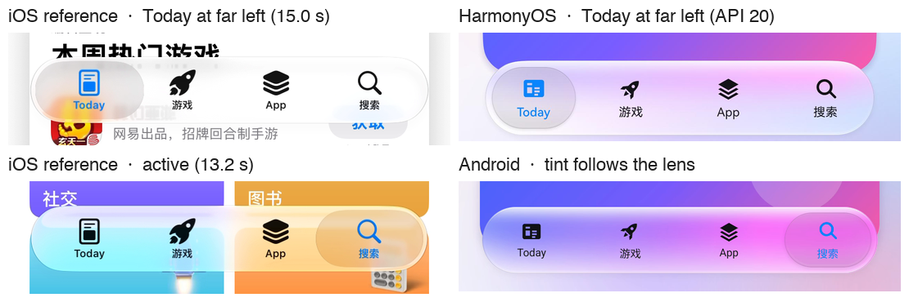
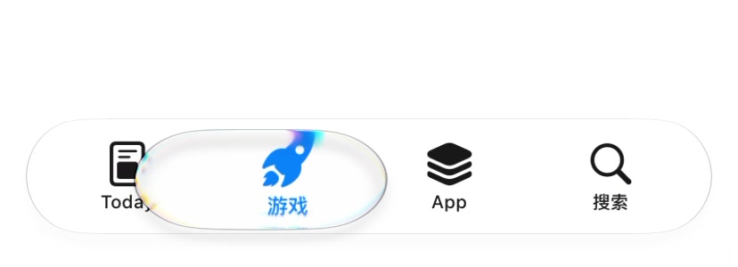
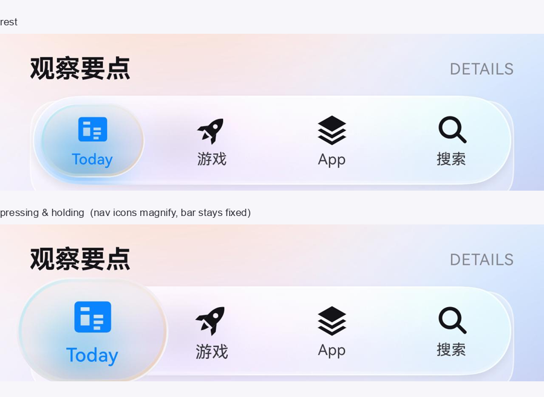
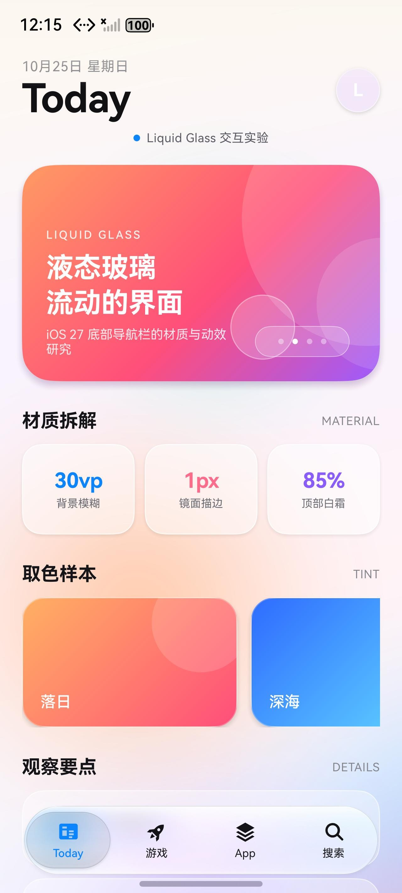
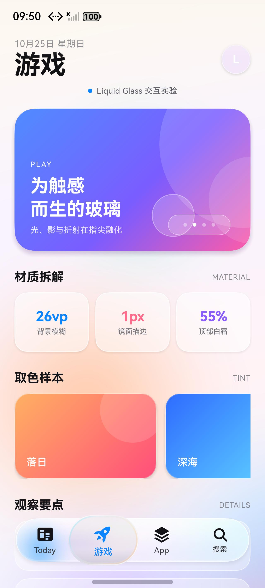
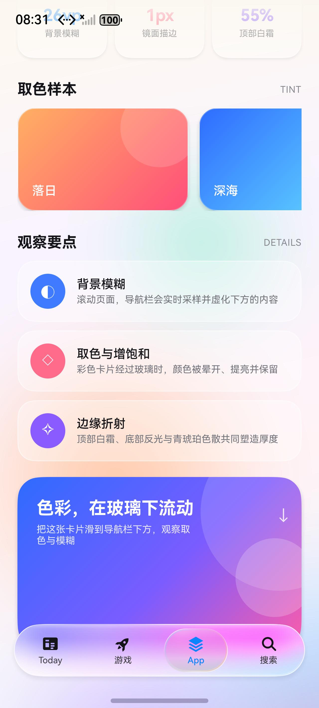

# iOS 27 液态玻璃底部导航栏 · 拆解与鸿蒙实现

> 参考素材：`ScreenRecording_10-25-2026 19-48-45_1.MP4`（828 × 1792，60 fps，19.25 s）
> 实现环境：DevEco Studio / HarmonyOS SDK 26，目标模拟器 API 20，HarmonyOS 模拟器（1280 × 2832）
> 构建配置：`compatibleSdkVersion 4.0.0(10)`；实际使用的能力下限为 **API 12**（见文末说明）



---

## 1. 视频里到底发生了什么

这段录屏是 iOS 27 App Store 的底部标签栏。它不是传统“贴着屏幕底边、横贯全屏”的 TabBar，而是一块**悬浮的液态玻璃胶囊**：

- 四个标签：`Today / 游戏 / App / 搜索`。
- 整条栏悬浮在内容之上，左右留边、底部留边，四角为完整半圆。
- 内容（彩色卡片、文字、图标）会从栏下方滚过，栏实时采样背景并模糊。
- 点击标签时，选中态不是简单的“换个底色”，而是一颗**会膨胀、会流动的玻璃透镜**在标签之间弹射。
- 选中标签的图标和文字变为系统蓝，未选中为近黑色。

---

## 2. 几何尺寸（按 2x 像素反推）

| 项目 | 视频测量 | 换算 |
| --- | --- | --- |
| 屏幕 | 828 × 1792 px | 414 × 896 pt |
| 胶囊栏 | 740 × 120 px | 370 × 60 pt |
| 左右留边 | 44 px | 22 pt |
| 底部留边 | 40 px | 20 pt |
| 圆角 | 60 px | 30 pt（= 高度的一半） |
| 标签单元 | 185 px | 92.5 pt |
| 图标 | ≈ 40 px | ≈ 20 pt |
| 文字 | ≈ 20 px | ≈ 10 pt |
| 选中透镜 | ≈ 167 × 102 px | ≈ 83.5 × 51 pt |
| 透镜内缩 | ≈ 10 px | ≈ 5 pt |

也就是：**栏高 60 pt、胶囊半径 30 pt、四个等宽标签、选中态是一颗比标签略窄的胶囊**。

---

## 3. 材质：不是“半透明白”，而是五层叠加

逐帧取色后，这条栏至少由五层组成：

### 3.1 背景模糊 + 增饱和

栏后的内容被明显模糊，但仍保留大色块的方向和色相。视频里紫色卡片经过栏下时会变成柔和的淡紫，橙色卡片会变成奶油橙，而不是纯灰。

在鸿蒙上对应：

```ts
.backgroundEffect({
  radius: 26,       // 实时背景模糊
  saturation: 2.0,  // 把背景的颜色“提”出来
  brightness: 1.06
})
```

### 3.2 顶部白霜 → 中部清澈 → 底部反光

这是最容易被忽略、却最像“玻璃”的一层：

- 顶部 10%–20% 有一条明显的奶白色霜带（视频取色约 62%–78% 白）。
- 中部白度快速下降，背景颜色透出来。
- 底部再出现一条较亮的反光边，像是玻璃的“下唇”。

实现为一条纵向白色渐变：

```ts
.linearGradient({
  angle: 180,
  colors: [
    ['#8CFFFFFF', 0.00],  // 55% 白，顶部霜
    ['#3DFFFFFF', 0.09],
    ['#08FFFFFF', 0.28],
    ['#00FFFFFF', 0.60],  // 中部几乎全透
    ['#08FFFFFF', 0.86],
    ['#24FFFFFF', 1.00]   // 底部反光
  ]
})
```

### 3.3 1 px 镜面描边

玻璃边缘有一圈极细的高光，左上最亮，右下稍暗，底部又回亮。它不是普通 `border`，因为普通边框颜色是均匀的。

`GlassRim.ets` 用 Canvas 画了一条**带渐变描边**的圆角路径：

- 主描边 `1.0 vp`：左上 90% 白 → 中段 12% → 右下 72% 白。
- 内侧 `1.7 vp` 的底部反光线。
- 顶部左肩的柔和镜面高光。
- 可选青色 / 琥珀色色散边（选中透镜用）。

### 3.4 极轻的冷色调

`#0A8FA8C8` 的一层薄冷色，避免白色材质在暖色背景上发黄。肉眼几乎不可见，但能让玻璃更“干净”。

### 3.5 投影

视频里的投影非常克制，只在栏底形成一条很浅的暗带。模拟器对 `shadow` 的模糊支持不稳定，因此实现里使用了很小的平台阴影；真正的“深度”主要交给底部反光和透镜内阴影。

---

## 4. 选中态：一颗会呼吸的玻璃透镜

视频里最“液态”的部分是选中透镜：

1. **静止时**：它是一颗略窄于标签的胶囊，比栏体更清透，边缘更亮；在纯白背景上会呈现极浅的灰色（约 `#E4E4E4`，而栏体是 `#F8F8F8`），说明它比栏体更“透明 + 内阴影”。
2. **按下 / 切换时**：透镜迅速膨胀到约 **1.2–1.5 倍**，上下会微微鼓出栏体，像一滴水。
3. **边缘色散**：透镜边缘能看到很细的青、琥珀色边，模拟真实镜片的色散。
4. **回弹**：膨胀结束后不是线性缩回，而是带过冲的弹簧；整个切换约 **0.5–0.7 s**。
5. **位移**：透镜从旧标签“流”到新标签，途中保持膨胀，落位后收窄。

实现参数（`LiquidTabBar.ets`）：

```ts
// 位移
ui.animateTo({
  duration: 640,
  curve: curves.springMotion(0.42, 0.7) // 有轻微过冲
}, () => { this.bubbleX = targetX; });

// 膨胀
ui.animateTo({ duration: 170, curve: Curve.EaseOut }, () => {
  this.bloomX = 1.35;
  this.bloomY = 1.35;
  this.glow = 0.95;
});

// 170 ms 后回弹
ui.animateTo({
  duration: 520,
  curve: curves.springMotion(0.52, 0.82)
}, () => {
  this.bloomX = 1;
  this.bloomY = 1;
  this.glow = 0;
});
```

透镜内部同样是分层：

- `backgroundEffect(radius: 9, saturation: 1.28)`：比栏体再“聚”一点色。
- `#10000000` 的极轻烟熏色：让它在白背景上呈现浅灰。
- 顶部 28% 白、底部 22% 白的薄高光。
- 底部 `#1A000000 → 透明` 的内阴影，制造玻璃厚度。
- `GlassRim` 色散描边。

> 按最新交互要求，透镜在点击时会明显高出、长出栏体：约 `67.5 vp` 高（上下各超出约 3.75 vp）、约 `95 vp` 长，左右两端最多超出约 7.3 vp。这里不再对透镜做栏体裁剪，让玻璃、模糊与描边一起溢出，形成参考视频里“液体鼓起”的体积感。

膨胀过程中，玻璃填充、内阴影与描边保持与静止时相同的透明度，不随放大而变淡或变透明；放大后只是同一块玻璃变得更大。

**放大只作用于导航栏自身**：四个 TabItem 的图标与文字会根据其到气泡中心的距离放大（约 1.0–1.3×），栏后的页面内容不缩放，只保留玻璃的背景模糊与取色。这样气泡像一枚盖在导航栏上的透镜，而不是放大页面内容。



---

## 5. 动效节奏

| 阶段 | 时长 | 曲线 | 说明 |
| --- | --- | --- | --- |
| 按下 | 130 ms | EaseOut | 图标轻微缩小（0.95），标签和图标变蓝 |
| 按住 | 260 ms | spring(0.32, 0.78) | **导航栏不缩放，选中气泡 1.45×**，明显高出、长出栏体 |
| 拖动 | 实时 | — | `bubbleX` 跟随手指，不吸附标签；松手落到最近标签 |
| 松开 | 360 ms | spring(0.42, 0.86) | 整条栏回弹到 1.0 |
| 透镜膨胀 | 170 ms | EaseOut | 1.35 × 1.35，明显高出、长出栏体；填充与描边保持不变 |
| 最大膨胀 | 与膨胀同步 | — | 清晰度与静止时一致；导航栏图标/文字放大 1.0–1.3×，页面内容不缩放 |
| 透镜位移 | 640 ms | spring(0.42, 0.7) | 带过冲，途中保持膨胀 |
| 透镜回弹 | 520 ms | spring(0.52, 0.82) | 回到 1.0，bloom 淡出 |
| 内容切换 | 即时 | — | 标题、主视觉、主题色切换 |

按住时导航栏本体保持原尺寸，选中透镜以 1.45× 膨胀（约 72.5 vp 高、102 vp 长），上下与左右都会明显超出栏体；玻璃填充与描边保持原样，放大前后清晰度一致，不会变透明。气泡下的导航栏图标/文字按到气泡中心的距离放大 1.0–1.3×，页面内容保持原尺寸。



内容切换使用“硬切”而不是渐变，是为了避免 ArkUI 在 `animateTo` 中插值渐变色时出现中间脏色（例如橙紫 → 蓝紫会被插值成橄榄绿）。

---

## 6. 鸿蒙实现结构

```
entry/src/main/ets/
├── pages/Index.ets                 // 页面、滚动内容、沉浸式安全区
└── components/
    ├── LiquidTabBar.ets            // 液态玻璃 TabBar
    ├── GlassRim.ets                // Canvas 镜面描边 / 色散 / 高光
    └── AuroraBackground.ets        // 会缓慢漂移的彩色背景
```

### 6.1 为什么不用系统材质

SDK 26 提供了 `uiMaterial.ImmersiveMaterial`（`systemMaterial`），但：

- 它是 API 26 才有的能力；
- 当前调试目标是 API 20 的鸿蒙模拟器；
- 它的风格是鸿蒙“沉浸光感”，并非视频里的 iOS 液态玻璃。

因此这里采用**手写分层**，全部能力都落在 API 20 以内，保证模拟器可运行。工程当前的 `compatibleSdkVersion` 是 `4.0.0(10)`，但代码实际使用了 `backgroundEffect`（API 11）、`clip`（API 12）与 `getUIContext`（API 11），真实下限应为 **API 12**；若需要支持 API 10/11，需要替换这些能力或提高兼容版本。

### 6.2 图层结构

```
Stack
├── 背景光晕 PNG（bloom，切换时短暂出现）
├── 玻璃底座（clip 成胶囊）
│   ├── backgroundEffect 实时模糊 + 增饱和
│   ├── 白色纵向渐变（顶部霜 / 中部透 / 底部反光）
│   ├── 冷色薄片
│   └── GlassRim（镜面描边 + 反光 + 高光）
├── 选中透镜（鼓出栏体，清晰度不变）
│   ├── backgroundEffect 二次聚色
│   ├── 烟熏色 + 白色高光渐变
│   ├── 底部内阴影
│   └── GlassRim（带青色 / 琥珀色色散）
└── 图标 + 文字（始终清晰地位于最上层）
```

细节：

- 栏体 `60 vp` 高，`322 vp` 宽（屏幕宽 − 44），两端半径 30。
- 选中透镜 `72.5 × 50 vp`，横向内缩 5 vp。
- 图标 23 vp，文字 10 fp，选中色 `#0A84FF`。
- 背景光晕与透镜都用 PNG 预渲染，避免运行时光晕出现色带或黑边。

### 6.3 按住的“呼吸”

选中透镜绑定 `bloomX / bloomY`：

```ts
// 按下：导航栏本体不动，选中气泡大幅膨胀，保持到松手
ui.animateTo({ duration: 320, curve: curves.springMotion(0.34, 0.7) }, () => {
  this.bloomX = 1.45;
  this.bloomY = 1.45;
  this.glow = 1;
});
```

透镜不做栏体裁剪，所以按住时玻璃、模糊、描边与光晕会一起溢出胶囊；松手后再由 `selectTab` 收回 1.0 并完成切页。

缩放只影响视觉层，不改变布局；按下时的触摸目标已被捕获，松手后由 `TouchType.Up` 统一提交标签切换。触控结束后的尾随 `onClick` 通过 `touchActive / lastTouchEnd` 忽略，避免把标签改回原来的 index；无障碍点击仍走 `onClick`。

### 6.4 跟手流动

按下后，气泡不再停在当前标签，而是滑到手指下方；`Move` 时直接跟随，不做标签吸附：

```ts
// 手指在导航栏内的横坐标（触摸点在 TabItem 内的 x + 该 Tab 的偏移）
const barX = this.tabW() * index + touch.x;
// 气泡中心对准手指，并限制在栏内
this.bubbleX = Math.max(0, Math.min(
  this.barW - this.bubbleW(),
  barX - this.bubbleW() / 2
));
```

- 四个 `TabItem` 按到气泡中心的距离放大（`itemMagnify`），所以气泡滑过时导航栏图标/文字会连续鼓起；
- 页面内容不参与任何缩放；
- 松手时按气泡中心找最近标签，由 `selectTab` 弹到该标签；
- 纵向拖出栏外超过 60 vp 视为取消，气泡回到当前选中标签。


### 6.5 真实背景采样

`backgroundEffect` 是真正的“取背后内容并模糊”，不是半透明遮罩。因此：

- 彩色卡片滑到栏下，栏会变成对应的颜色；
- 文字滑到栏下，会变成柔和的色块；
- 不同标签位置、不同滚动位置，栏的颜色都不同。

这也是为什么演示页特意做了一张**大面积高饱和的收尾卡片**：把它滑到栏下，玻璃的取色和模糊会非常明显。

### 6.6 滚动与安全区

- 页面用 `setWindowLayoutFullScreen(true)` 进入沉浸式。
- 通过 `window.getWindowAvoidArea()` 取状态栏 / 导航条高度，分别控制顶部留白和胶囊栏的底部距离。
- 内容底部只留 `36 vp`，让最后一张彩色卡片可以滚到导航栏正下方。

---

## 7. 还原度对照

| 特征 | iOS 27 参考 | 鸿蒙实现 | 说明 |
| --- | --- | --- | --- |
| 悬浮胶囊 | ✅ | ✅ | 60 vp 高，左右 22 vp 留边 |
| 实时背景模糊 | ✅ | ✅ | `backgroundEffect` |
| 顶部白霜 / 底部反光 | ✅ | ✅ | 纵向白色渐变 |
| 1 vp 镜面描边 | ✅ | ✅ | Canvas 渐变描边 |
| 选中透镜 | ✅ | ✅ | 独立玻璃胶囊 |
| 膨胀 + 弹簧位移 | ✅ | ✅ | 170 ms 膨胀 + 640 ms spring |
| 青 / 琥珀色散 | ✅ | ✅（近似） | Canvas 双色描边 |
| 真实折射 / 放大 | ✅ | ⚠️ 近似 | ArkUI API 20 不暴露背景位移采样 |
| 字体 | SF Pro | HarmonyOS Sans | 系统字体差异 |
| Home Indicator | 系统 | 系统 | 模拟器样式不同 |

最大的差异是**真实折射**：iOS 的透镜会把下面的内容轻微放大、弯折，并产生色散；ArkUI 目前只能拿到“模糊后的背景”，无法对背景做位移采样。因此实现用“增饱和 + 烟熏 + 镜面描边 + 色散边 + 膨胀”去逼近这种光学感，而不是逐像素折射。

---

## 8. 运行

```bash
# 构建
export DEVECO_SDK_HOME=/Applications/DevEco-Studio.app/Contents/sdk
/Applications/DevEco-Studio.app/Contents/tools/hvigor/bin/hvigorw --no-daemon assembleHap

# 安装到已启动的模拟器
hdc -t 127.0.0.1:5555 install -r \
  entry/build/default/outputs/default/entry-default-unsigned.hap

# 启动
hdc -t 127.0.0.1:5555 shell aa start \
  -a EntryAbility -b io.xuxiaowei.liquidglass
```

> 模拟器处于开发者模式，可直接安装未签名 HAP。DevEco 会自动生成调试签名与 `entry-default-signed.hap`，但当前模拟器与这份签名信息不一致（`install sign info inconsistent`），所以模拟器调试使用未签名包；真机请在 DevEco Studio 中配置自动签名。

---

## 9. 截图

| 首屏 | 彩色卡片滑到栏下 |
| --- | --- |
|  |  |

| 切换瞬间（透镜膨胀） | App 标签 |
| --- | --- |
|  |  |
