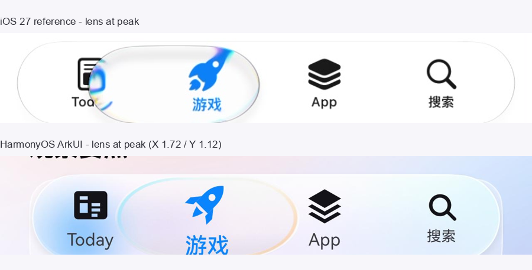
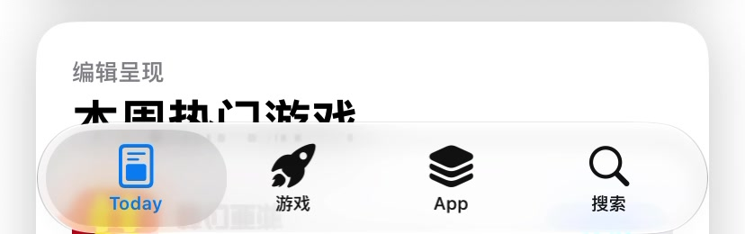
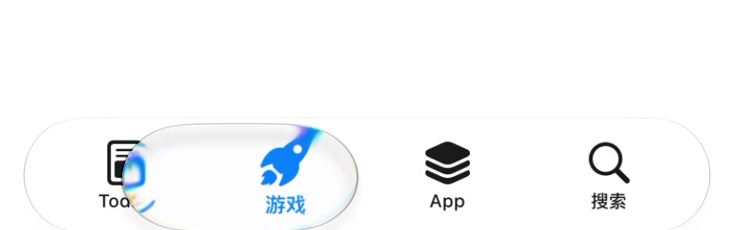

# 逐帧拆解：视频里的液态玻璃导航栏 vs 当前实现

> 视频：`ScreenRecording_10-25-2026 19-48-45_1.MP4`，828 × 1792，60fps，19.25s
> 取样：1.80s–2.60s，共 48 帧（60fps），裁切底部导航栏
> 代码：[LiquidTabBar.ets](../entry/src/main/ets/components/LiquidTabBar.ets)、[GlassRim.ets](../entry/src/main/ets/components/GlassRim.ets)



---

## 1. 关键帧时间线

| 时间 | 帧 | 状态 | 透镜尺寸（px / pt） | 说明 |
| --- | --- | --- | --- | --- |
| 1.80s | f_001 | Today 选中 | 167 × 102 / 83.5 × 51 | 静止透镜，收在栏内 |
| ≈2.10s | f_019 | Today，开始膨胀 | ≈230 × 104 / 115 × 52 | 中心开始变宽，图标开始变大 |
| 2.283s | f_030 | Today，膨胀峰值附近 | ≈280 × 105 / 140 × 52.5 | 透镜横跨 Today + 游戏，Today 仍蓝 |
| 2.383s | f_036 | Today → 游戏 之间 | ≈285 × 108 / 142.5 × 54 | 透镜继续变宽，Today 文字被盖住 |
| 2.483s | f_042 | 游戏 选中 | ≈290 × 110 / 145 × 55 | 透镜落到游戏，游戏变蓝，边缘出现青/琥珀色散 |
| 2.583s | f_048 | 游戏，回弹 | ≈220 × 104 / 110 × 52 | 透镜收窄，准备回到静止尺寸 |




---

## 2. 视频里真正发生了什么

### 2.1 透镜主要是“变长”，不是“变高”

这是最容易做错的一点。按 2x 像素测量：

- 静止透镜：**83.5 × 51 pt**（约占标签宽 90%，栏高 85%）
- 峰值透镜：**≈145 × 55 pt**（约占标签宽 156%，栏高 92%）

即：

- **长度增加 ≈ 74%**
- **高度只增加 ≈ 8%**

视频里看起来“很高”的部分，很大一块是透镜外部的**柔光/模糊晕染**，不是玻璃本体。玻璃本体在峰值时仍基本收在 60pt 的栏高内，只轻微顶到上下边缘。

### 2.2 导航栏本体不动

视频中栏体始终是 **370 × 60 pt**，左右 22pt 留边、圆角 30pt。放大只发生在透镜和透镜下的图标/文字，栏体本身没有缩放。

### 2.3 透镜是“清玻璃”，不是白色胶囊

- 透镜中心接近透明，能透出下方栏体和图标；
- 边缘是一圈很薄的亮白描边；
- 紧贴图标和圆弧的地方有明显**青 / 蓝 / 琥珀**色散；
- 透镜比它所在的栏体更“清透”，栏体本身反而更奶白（顶部白霜更重）。

### 2.4 图标在透镜下被放大

视频里 Today、游戏的图标与文字在透镜下明显变大，约 **1.4–1.5×**；页面内容不参与缩放。

### 2.5 页面内容不被放大

栏体后面的卡片、文字只被玻璃**模糊 + 取色**，没有跟着透镜一起放大。放大只作用于导航栏自身的图标/文字。

### 2.6 动效节奏

- 膨胀：约 **0.15–0.2s**
- 从 Today 流到游戏：约 **0.2–0.3s**，途中保持宽而扁的形态
- 回弹：约 **0.3–0.5s**
- 整体是一次短促的“鼓起 → 流过去 → 收窄”，不是长时间悬停。

---

## 3. 当前代码的对应实现

| 特征 | 视频 | 当前实现 |
| --- | --- | --- |
| 栏体 | 370 × 60 pt，左右 22pt | 322 × 60 vp，左右 22vp（屏幕 366vp） |
| 静止透镜 | 83.5 × 51 pt | 72.5 × 51 vp（占标签 90%、栏高 85%） |
| 峰值透镜 | ≈145 × 55 pt | 124.7 × 57.1 vp（X 1.72 / Y 1.12） |
| 长度增长 | +74% | +72% |
| 高度增长 | +8% | +12% |
| 栏体缩放 | 无 | 无（已移除 `barScale`） |
| 透镜材质 | 清玻璃 + 亮边 + 色散 | 低白量清玻璃 + `GlassRim` 色散 |
| 图标放大 | ≈1.4–1.5× | 最高 1.5×（按到透镜中心距离衰减） |
| 页面内容 | 不放大 | 不放大 |
| 色散 | 青 / 琥珀，贴近图标与边缘 | `GlassRim` 青→琥珀描边，透明度 0.68 / 0.62 |

### 3.1 透镜几何

```ts
const ITEM_GAP: number = 8;      // 静止透镜宽 = tabW - 8
bubbleH = barH - 9;              // 51vp

// 点击 / 按住
this.bloomX = 1.72;              // 横向拉长
this.bloomY = 1.12;              // 只轻微增高
```

峰值尺寸：

- 宽：`72.5 × 1.72 ≈ 124.7vp`（标签的 1.55 倍）
- 高：`51 × 1.12 ≈ 57.1vp`（栏高的 0.95 倍）

### 3.2 清玻璃透镜

透镜的填充被压到很低：

- 白色高光：顶部 15%、底部 12%
- 烟熏色：3%
- 背景模糊：半径 6

这样透镜中心能透出栏体与图标，保留视频里的“清玻璃”感，同时不会变成完全透明。

### 3.3 图标放大

```ts
private itemMagnify(index: number): number {
  // 距离透镜中心越近，放大越多，最中心约 1.5×
  return 1 + influence * bloom * 0.50;
}
```

只作用于 `TabItem` 的图标和文字，栏体本身与页面内容都不缩放。

### 3.4 边缘色散

`GlassRim` 在透镜边缘画一圈青 → 透明的描边，再叠琥珀色；峰值时透明度 0.68 / 0.62，线宽 1.5。


---

## 4. 仍然存在的差异

1. **真实折射**：视频里透镜下的图标会被轻微弯折，并在图标周围产生彩色拖影；ArkUI API 20 没有背景位移/自定义 fragment shader，当前用“图标放大 + 边缘色散”近似，图标本身仍是清晰的。
2. **字体**：HarmonyOS Sans vs SF Pro。
3. **图标尺寸**：当前 23vp，视频约 20pt；这是之前“图标大一点”的需求保留，若严格按视频可降到 20–21vp。
4. **栏宽**：当前 322vp / 366vp（88%），视频 370pt / 414pt（89.4%），比例接近，但绝对留边略大。

---

## 5. 复现取样

```bash
ffmpeg -ss 1.8 -t 0.8 -i input.mp4 \
  -vf "fps=60,crop=828:260:0:1490" -q:v 2 frames/f_%03d.jpg
```

对应关键帧：

- `f_030.jpg`：2.283s，Today 侧膨胀峰值
- `f_042.jpg`：2.483s，游戏侧透镜峰值
- `f_048.jpg`：2.583s，回弹
